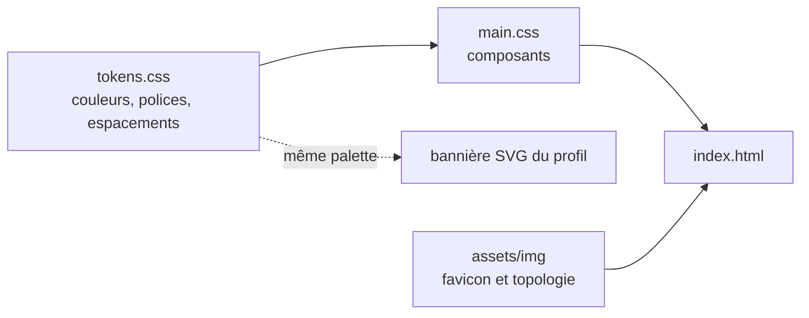

# Système de design

> [!NOTE]
> Le portfolio et le profil GitHub (`Bazeeza/Bazeeza`, `assets/banniere.svg`) utilisent la même palette. Une couleur, une police ou un espacement se change **dans `assets/css/tokens.css`**, jamais directement dans `main.css`.

## Organisation des fichiers

| Fichier | Rôle |
|---|---|
| `assets/css/tokens.css` | Variables CSS : seule source des valeurs brutes |
| `assets/css/main.css` | Composants : base, barre d'état, héros, sections, cartes, chronologie, pied de page |
| `assets/img/favicon.svg` | Icône d'onglet (invite de terminal) |
| `assets/img/topologie.svg` | Illustration décorative du héros, animée en CSS |

## Couleurs

Chaque couleur de signal a **un seul sens**, pour que la page reste lisible d'un coup d'œil.

| Jeton | Valeur | Usage |
|---|---|---|
| `--color-bg` | `#070d1c` | Fond de la page |
| `--color-surface-sunken` | `#0a1226` | Barre d'état, étiquettes |
| `--color-surface` | `#0d1730` | Cartes, boutons secondaires |
| `--color-border` | `#1d3157` | Bordures décoratives, séparateurs |
| `--color-border-strong` | `#2c4778` | Bordure des boutons |
| `--color-text` | `#e6edf3` | Texte principal, titres |
| `--color-text-muted` | `#8b99a8` | Paragraphes |
| `--color-text-dim` | `#7f8ea3` | Métadonnées (dates, libellés) |
| `--color-on-accent` | `#04140d` | Texte posé sur un fond vert |
| `--color-green` | `#3fe0a0` | Lien actif, action principale, élément en cours, focus, projet phare |
| `--color-blue` | `#2b9dff` | Structure : numéros de section, titres de groupe, accent des projets de cours |
| `--color-amber` | `#ffb454` | Attention, lien de secours |
| `--color-violet` | `#c792ea` | Supervision, mise en valeur secondaire |

### Contrastes (WCAG 2.2, niveau AA)

Le niveau AA demande **4,5:1** pour le texte normal et **3:1** pour le grand texte et les indicateurs de focus. Les ratios ci-dessous ont été calculés avec la formule de luminance relative de la WCAG, puis arrondis vers le bas.

| Texte | Sur `--color-bg` | Sur `--color-surface` | Résultat |
|---|---|---|---|
| `--color-text` | 16,4:1 | 15,0:1 | AAA |
| `--color-text-muted` | 6,6:1 | 6,1:1 | AA |
| `--color-text-dim` | 5,8:1 | 5,3:1 | AA |
| `--color-green` | 11,4:1 | 10,4:1 | AAA |
| `--color-blue` | 6,8:1 | 6,2:1 | AA |
| `--color-amber` | 11,0:1 | 10,0:1 | AAA |
| `--color-violet` | 8,0:1 | 7,3:1 | AAA |
| `--color-on-accent` sur `--color-green` | 11,2:1 | — | AAA |

> [!NOTE]
> L'ancien gris des métadonnées, `#5d6b7a`, donnait environ 3,6:1 sur le fond : trop peu pour du texte de 12 px. Il a été remplacé par `#7f8ea3`.

Les bordures `--color-border` sont décoratives : les boutons et les cartes se reconnaissent à leur texte. Elles n'ont donc pas besoin d'atteindre 3:1.

## Typographie

Polices **système** : aucune police n'est téléchargée. La page s'affiche donc sans attendre, et l'adresse IP des visiteurs n'est envoyée à aucun tiers. Ce sont les mêmes familles que dans la bannière du profil.

| Jeton | Pile de polices |
|---|---|
| `--font-sans` | Segoe UI, system-ui, -apple-system, Roboto, Helvetica Neue, Arial |
| `--font-mono` | Consolas, Cascadia Mono, SFMono-Regular, Menlo, Liberation Mono |

| Jeton | Taille | Usage |
|---|---|---|
| `--text-xs` | 12 px | Étiquettes, dates, pied de page |
| `--text-sm` | 14 px | Boutons, menu, faits |
| `--text-base` | 16 px | Paragraphes |
| `--text-lg` | 18 px | Accroche, postes |
| `--text-xl` | 20 px | Titres de projet |
| `--text-2xl` | 26 px | Titres de section |
| `--text-display` | 34 à 60 px | Nom dans le héros (`clamp`) |

Les tailles sont en `rem` : elles suivent la taille de texte choisie dans le navigateur.

## Espacements, formes, mouvement

- Grille de **4 px** : `--space-1` (4 px) à `--space-8` (72 px).
- Rayons : `--radius` 6 px (cartes, boutons), `--radius-sm` 3 px (étiquettes).
- Largeur du contenu : `--content-width` 60 rem.
- Durée des transitions : `--duration` 0,2 s. Avec `prefers-reduced-motion: reduce`, toutes les animations s'arrêtent, y compris celle de `topologie.svg`.
- Une animation ne touche que `transform` et `opacity` (la pastille d'état est un pseudo-élément qui grandit et s'efface), jamais `box-shadow`, `width` ou `top`, qui obligent à repeindre la page à chaque image.

## Points de rupture

| Largeur | Changement |
|---|---|
| ≤ 860 px | Héros sur une colonne, illustration décorative masquée |
| ≤ 720 px | « À propos » et compétences sur une colonne |
| ≤ 620 px | Menu sous l'invite, sur plusieurs lignes au besoin ; barre d'état non collante |
| ≤ 520 px | Marges de section et de carte réduites, titre et métadonnées des cartes empilés, faits « libellé puis valeur » |
| `pointer: coarse` | Écran tactile : liens du menu, boutons et liens des cartes d'au moins 44 px de haut |

Objectif : lisible dès **320 px** de large sans défilement horizontal (critère WCAG 1.4.10, *Reflow*). À vérifier dans un navigateur à chaque changement de mise en page.

## Composants

| Composant | Classe | Notes |
|---|---|---|
| Barre d'état | `.statusbar` | En-tête collant ; sous 620 px, le menu passe sous l'invite au lieu de disparaître |
| Lien d'évitement | `.skip-link` | Invisible jusqu'au premier appui sur Tab |
| Bouton | `.btn`, `.btn.primary` | Une seule action principale par zone |
| En-tête de section | `.sec-head` | Numéro et trait décoratifs (`aria-hidden`), titre `h2` |
| Faits | `.facts` | Liste de description `dl` / `dt` / `dd` |
| Étiquette | `.tag` | Élément de liste `li` dans `ul.tags` |
| Groupe de projets | `.proj-group` | Titre `h3` en bleu (structure) ; la note `.proj-group-note` précise le groupe |
| Carte projet | `.project` | `article` avec titre `h4` ; bord gauche bleu pour un projet de cours |
| Carte projet phare | `.project.featured` | Dépôt public maintenu : bord gauche vert (« actif ») |
| Code en ligne | `.project code` | Option ou commande citée dans une carte (`-WhatIf`, `127.0.0.1`) |
| Autres réalisations | `.other-list` | Une ligne par projet secondaire, sans carte : lien puis description |
| Chronologie | `.exp` | Liste ordonnée `ol`, dates dans `time` ; emplois triés par date de fin, le plus récent en haut (`.now` = emploi en cours) |

## Règles d'accessibilité

1. Un seul `h1`, puis `h2` par section et `h3` dans les sections : aucun niveau sauté. Dans « Projets », les groupes sont des `h3` et les projets des `h4`.
2. Repères : `header`, `nav` (avec `aria-label`), `main`, `footer`.
3. Le focus clavier est **toujours visible** (`:focus-visible`, contour de 2 px).
4. Les symboles décoratifs (flèches, enveloppe, puce de l'invite) sont `aria-hidden`.
5. Un lien qui ouvre un nouvel onglet l'annonce avec un texte masqué visuellement.
6. Une image décorative a `alt=""` ; une image qui informe a un `alt` qui dit ce qu'elle montre.
7. Un fragment en anglais dans la page française (menu `./about`, `LINK STATUS: UP`, `exit code 0`) porte `lang="en"` : le lecteur d'écran change de voix au lieu de le prononcer « à la française » (critère 3.1.2).
8. Toute liste `ul` / `ol` dont les puces sont retirées en CSS porte `role="list"` : sinon Safari et VoiceOver ne l'annoncent plus comme une liste.
9. Un lien générique (« voir le dépôt ») reçoit le nom du projet en texte masqué visuellement. Le texte visible reste au début du nom accessible, pour la commande vocale (critère 2.5.3).
10. Cible tactile : au moins 24 × 24 px, ou assez d'espace autour du lien (critère 2.5.8) ; 44 px de haut sur écran tactile pour le menu, les boutons et les liens des cartes.

**Reference :** [WCAG 2.2](https://www.w3.org/TR/WCAG22/) · [Understanding SC 1.4.3 Contrast (Minimum)](https://www.w3.org/WAI/WCAG22/Understanding/contrast-minimum.html) · [Understanding SC 2.5.8 Target Size (Minimum)](https://www.w3.org/WAI/WCAG22/Understanding/target-size-minimum.html) · [Understanding SC 3.1.2 Language of Parts](https://www.w3.org/WAI/WCAG22/Understanding/language-of-parts.html) · [MDN, prefers-reduced-motion](https://developer.mozilla.org/en-US/docs/Web/CSS/@media/prefers-reduced-motion) · [MDN, ARIA list role](https://developer.mozilla.org/en-US/docs/Web/Accessibility/ARIA/Reference/Roles/list_role)
