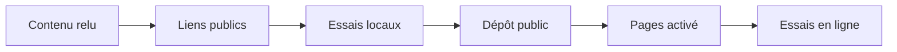

# Liste de vérification avant mise en ligne

> [!NOTE]
> Le dépôt est privé et le site hors ligne. Cette liste sert le jour où le propriétaire décide de le republier. Chaque case se coche **dans un navigateur**, sur la vraie page : rien ici ne remplace un essai réel.

## 1. Contenu

- [ ] Chaque carte de projet correspond encore au README de son dépôt (voir « Sources des projets » dans le [README](../README.md#sources-des-projets)).
- [ ] Les faits de « À propos » (formation, permis, disponibilité) sont exacts et cohérents entre eux.
- [ ] Aucune donnée personnelle de trop : ni téléphone, ni adresse, ni courriel personnel, ni nom d'employeur, ni détail de serveur. Contact public seulement.
- [ ] `lastmod` de `sitemap.xml` = date du dernier changement de contenu.

## 2. Liens

- [ ] Chaque lien de carte ouvre une page **publique** : un dépôt privé renvoie une erreur 404 à un visiteur non connecté. Tester dans une fenêtre de navigation privée.
- [ ] Les ancres du menu (`#about`, `#skills`, `#projects`, `#contact`) et le lien « Aller au contenu » mènent au bon endroit.
- [ ] Les liens `mailto:` ouvrent un message adressé au contact public.

## 3. Essais locaux

Serveur statique à la racine du dépôt (voir [Aperçu en local](../README.md#aperçu-en-local)), puis :

- [ ] Validateur HTML du W3C (onglet « Validate by file upload ») sur `index.html` et `404.html` : aucune erreur.
- [ ] Mode appareil des outils de développement à **320 px** et **375 px** : aucun défilement horizontal.
- [ ] Navigation au clavier seulement : focus toujours visible, ordre logique.
- [ ] Lighthouse (Chrome) : Performance, Accessibilité, Bonnes pratiques et SEO. Noter les scores dans le README seulement s'ils ont été mesurés.
- [ ] `http://localhost:8000/404.html` s'affiche avec ses styles.
- [ ] Aperçu avant impression (Ctrl+P) : texte noir sur blanc, aucune carte coupée.
- [ ] « Réduire les animations » activé dans le système : plus rien ne bouge.

## 4. Publication (propriétaire seulement)

- [ ] Rendre le dépôt public : *Settings* → *General* → *Danger Zone* → *Change visibility*. Avant, relire **tout l'historique**, pas seulement la dernière version des fichiers.
- [ ] *Settings* → *Pages* : source « Deploy from a branch », branche `main`, dossier `/ (root)`.
- [ ] Case *Enforce HTTPS* cochée.

## 5. Essais en ligne

- [ ] `https://bazeeza.github.io/` répond, et une adresse inventée (par exemple `/test-404`) affiche la page 404 personnalisée.
- [ ] `https://bazeeza.github.io/robots.txt` et `https://bazeeza.github.io/sitemap.xml` répondent.
- [ ] Test des résultats enrichis de Google sur l'adresse publique : les données structurées `Person` sont lues sans erreur.
- [ ] Aperçu d'un lien collé dans un message privé (LinkedIn ou Teams) : titre et description corrects. Sans `og:image`, l'aperçu n'a pas d'image : c'est attendu.
- [ ] Facultatif : déclarer le site dans Google Search Console et y soumettre le sitemap.

**Reference :** [GitHub Docs, Configuring a publishing source for your GitHub Pages site](https://docs.github.com/en/pages/getting-started-with-github-pages/configuring-a-publishing-source-for-your-github-pages-site) · [GitHub Docs, Securing your GitHub Pages site with HTTPS](https://docs.github.com/en/pages/getting-started-with-github-pages/securing-your-github-pages-site-with-https) · [GitHub Docs, Setting repository visibility](https://docs.github.com/en/repositories/managing-your-repositorys-settings-and-features/managing-repository-settings/setting-repository-visibility) · [W3C Markup Validation Service](https://validator.w3.org/) · [Google, Rich Results Test](https://search.google.com/test/rich-results) · [Chrome for Developers, Lighthouse](https://developer.chrome.com/docs/lighthouse/overview)
